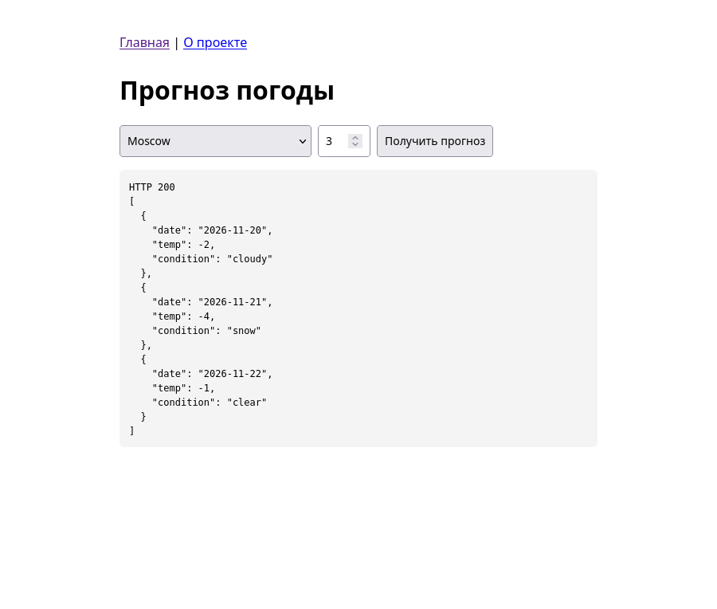
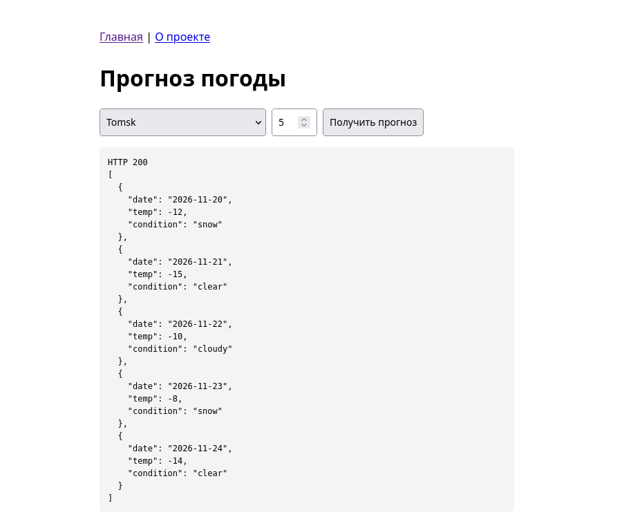
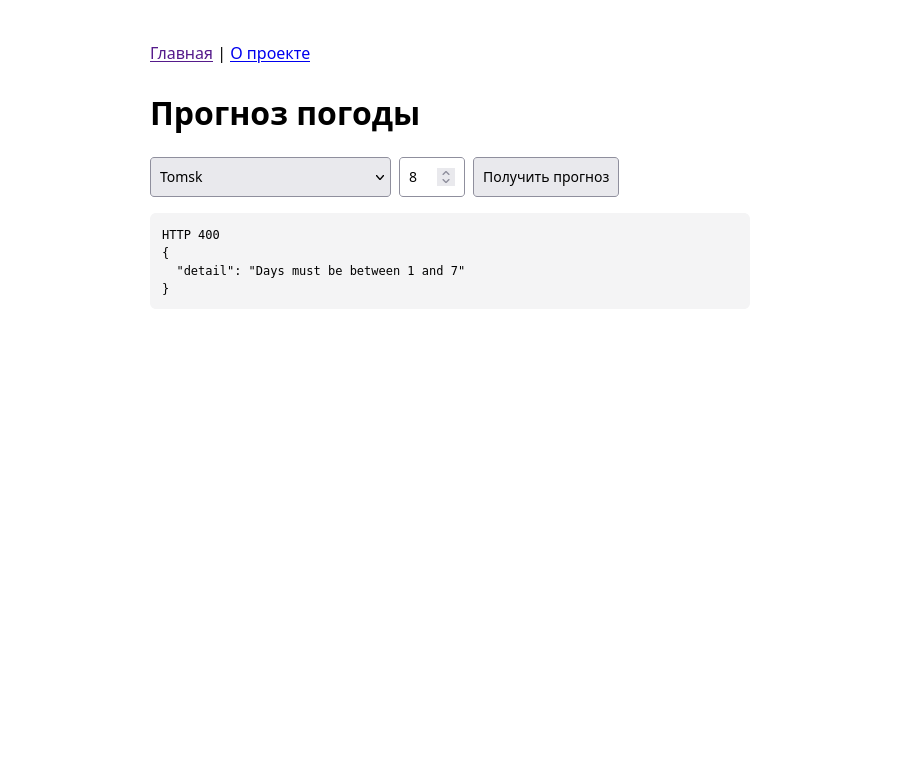
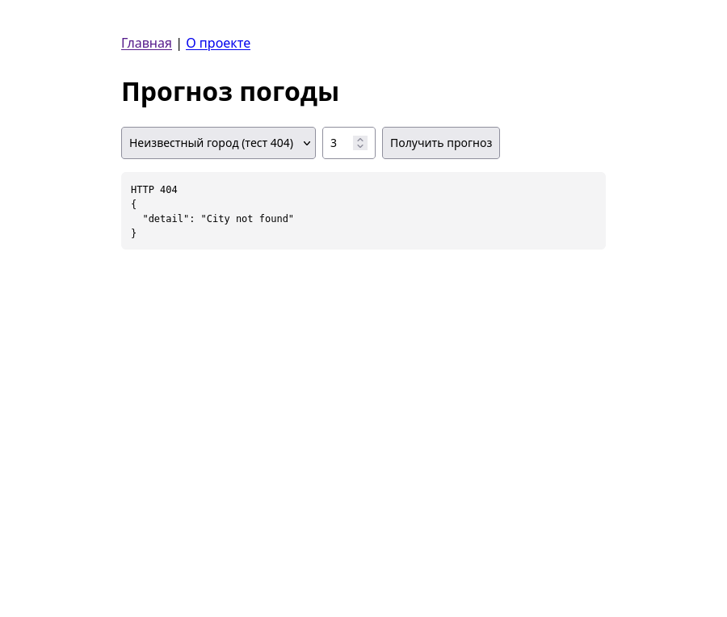
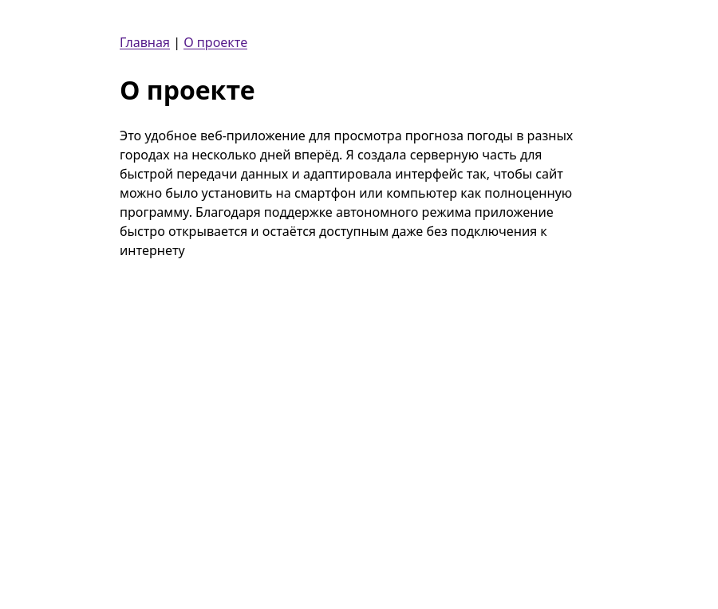
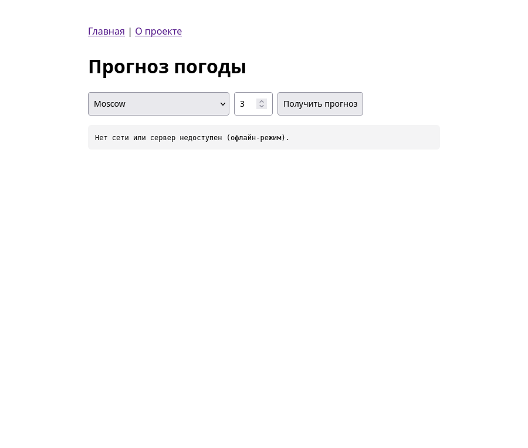

# Лабораторная работа №6 - «Прогноз погоды»

**О проекте.** Выберите город и посмотрите учебный прогноз на срок от одного до семи дней.

**Студентка - Елена Шалыгина · Группа 932403 · Вариант №11**

## Что я сделала

Я создала веб-приложение с прогнозом для Москвы, Томска и Лондона. По умолчанию форма запрашивает прогноз на три дня. После нажатия кнопки «Получить прогноз» результат появляется на той же странице. В нём видны HTTP-статус и данные по каждому дню: дата, температура и состояние погоды.

Для демонстрации ошибок в списке есть пункт «Неизвестный город». Также я добавила страницу «О проекте» и настроила кеширование страниц для офлайн-режима.

## Как я это сделала

| Часть | Реализация |
|---|---|
| Сервер | Python и FastAPI. Uvicorn запускает приложение, FastAPI отдаёт страницы и статику из `static/`. |
| API прогноза | `GET /api/forecast/{city}` принимает город в пути и число дней в параметре `days`. Сервер выбирает нужное количество записей из подготовленного набора тестовых данных. |
| Обработка ошибок | Некорректное число дней даёт `400`, неизвестный город - `404`. Для проверки доступности сервера есть `GET /api/status`. |
| Интерфейс | HTML, CSS и JavaScript. Форма запрашивает прогноз через `fetch` и выводит JSON вместе со статусом ответа. |
| PWA | Манифест задаёт название, иконки 192×192 и 512×512 и режим `standalone`. Service worker кеширует страницы и ресурсы интерфейса. |

## Что получилось на выходе

**Прогноз на три дня.** Для Москвы сервер вернул три записи и статус `200`.



**Прогноз на пять дней.** После выбора Томска и изменения числа дней форма показала пять записей.



**Проверка ввода.** Запрос на восемь дней дал `400`, а запрос для неизвестного города - `404`.





**Страница «О проекте».** На ней описано назначение приложения.



**Офлайн-режим.** После первой загрузки и кеширования главная открылась даже при остановленном сервере. Для получения прогноза нужен доступ к API, поэтому форма показала сообщение о недоступности сервера.



## Как запустить

Из папки лабораторной работы выполните команды.

```bash
python -m venv .venv
source .venv/bin/activate
python -m pip install -r requirements.txt
python -m uvicorn main:app
```

Откройте [главную страницу](http://127.0.0.1:8000/) или проверьте API напрямую.

```bash
curl -i 'http://127.0.0.1:8000/api/forecast/moscow'
curl -i 'http://127.0.0.1:8000/api/forecast/tomsk?days=5'
curl -i 'http://127.0.0.1:8000/api/forecast/tomsk?days=8'
curl -i 'http://127.0.0.1:8000/api/forecast/unknown'
```
